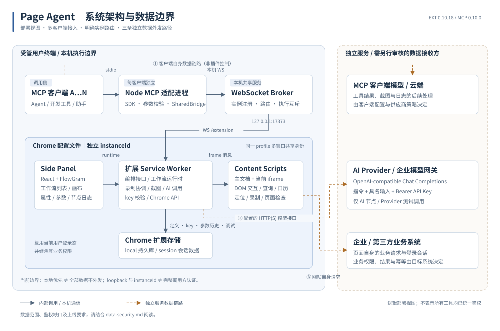
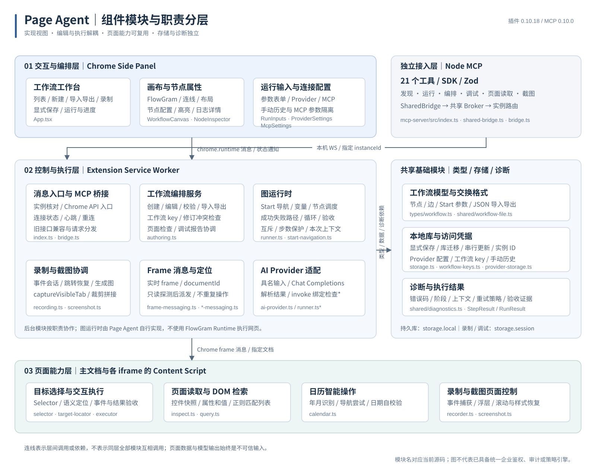

# 技术架构与整体设计思路

> 历史评估资料：本篇保留 2026-10-10 的技术评估基线，未按 0.10.66 全量重审。当前安装、界面、节点与 MCP 使用请阅读 [最新使用手册](../README.md)。

基线：插件 0.10.18，MCP Server 0.10.0。接口见 [API 文档](api-reference.md)，安全边界见[安全文档](data-security.md)。

## 1. 目标与定位

企业历史网页系统通常已经具备业务功能，却缺少易接入的接口。让模型每次重新理解页面、判断元素并逐步操作，难以复用已验证的业务路径。Page Agent 将这些路径保存为参数化、可编辑的工作流，让 Agent 在重复任务中调用既有能力，在创建和调试阶段按需读取页面。

核心设计是“可视化定义 + 自有浏览器运行时 + 本机 MCP 接入 + 可选 AI 节点”。这不是仅依靠模型逐步决策的浏览器代理，也不是完整的企业 RPA 调度平台。

## 2. 组件与信任边界

图 1：系统部署与通信视图。实线表示内部调用或本机通信，虚线表示独立服务数据链路；用户终端、Chrome 配置文件和外部服务边界分别标出。三条外发链路彼此独立，Page Agent 的本地执行不意味着目标网站和 MCP 客户端也在本地。[打开矢量原图](diagrams/system-architecture.svg)。

图 2：组件职责与实现分层。交互层、后台控制执行层、页面能力层及共享基础模块分开呈现，标注对应源码与层间通信方式；MCP 是独立接入层，FlowGram 仅负责编辑。图中聚合连线不是完整函数调用图，不代表所有同层模块互相依赖。[打开矢量原图](diagrams/component-modules.svg)。

### 2.1 组件职责

| 组件 | 职责 | 主要实现 |
| --- | --- | --- |
| Side Panel | 列表、新建、录制入口、编辑、参数弹窗、节点日志 | `src/sidepanel/App.tsx`、`WorkflowCanvas.tsx`、`NodeInspector.tsx` |
| FlowGram | 节点渲染、连线、布局、平移缩放 | `src/sidepanel/WorkflowCanvas.tsx` |
| Service Worker | Chrome API、消息路由、工作流执行及存储协调 | `src/background/index.ts`、`runner.ts` |
| Content Script | 当前文档内选择、定位、交互、查询、日历、录制 | `src/content/*` |
| Authoring 服务 | 创建、修改、校验、调试、导入导出 | `src/background/authoring.ts` |
| MCP Server | SDK 工具注册、参数校验、stdio 响应 | `mcp-server/src/index.ts` |
| SharedBridge | MCP 进程连接共享 broker，必要时启动后台 | `mcp-server/src/shared-bridge.ts` |
| Broker | 连接实例注册、请求分发、并发互斥、超时 | `mcp-server/src/bridge.ts`、`broker.ts` |
| Shared 数据层 | 库迁移、工作流 key、实例 ID、Provider 配置 | `src/shared/*` |

### 2.2 技术栈

插件使用 TypeScript、React 18、FlowGram free-layout editor、Vite 和 CRXJS；Chrome Manifest V3 提供 Side Panel、Service Worker、Content Script 与扩展存储。MCP 使用 Node.js、官方 MCP SDK、`ws` 和 Zod。测试使用 Vitest、jsdom 及 MCP 服务端测试。

具体安装版本以两个 `package-lock.json` 为准，不能把 `package.json` 的版本范围当作交付依赖清单。FlowGram 是编辑器，不是实际网页执行引擎。

## 3. 工作流领域模型

### 3.1 身份、定义与修订

每个工作流包含全局唯一 UUID、名称、节点、连线、创建和修改时间。`updatedAt` 是乐观并发修订标记，不是签名。每个浏览器配置文件保存独立的实例 UUID；同一配置文件的不同窗口共享实例身份。

调用指定工作流时通常需要 `instanceId + workflowId + key`。实例 ID 负责路由，工作流 ID 负责选择定义，key 负责该定义的访问校验。实例 ID 不是 Chrome 进程 PID，也不是认证凭据。

源代码保留 `ScriptDefinition`、`scripts` 等历史名称；产品界面统一称工作流。旧 Action 数据和接口仍有兼容代码，不能因为界面移除了“保存 Action”就假设底层能力已经删除。

### 3.2 节点

| 类型 | 作用 | 输出与执行边界 |
| --- | --- | --- |
| `start` | 输入声明、目标 URL、加载/登录等待、页面校验 | 每个新工作流唯一入口 |
| `dom` | 指定 CSS Selector 的输入、选择、点击等交互 | 校验可操作性与事件后状态 |
| `query` | 在选定范围检索子 DOM | 返回 JSON 快照列表，不是 live DOM 引用 |
| `calendar` | 单日期或区间日期选择 | 识别年月、导航按钮及日期，尝试翻页并校验 |
| `ai` | 调用模型分析具名输入，必要时发起受绑定的操作 | 内容会发送给 Provider |
| `wait` | 固定时长等待 | 不能代替业务状态判断 |
| `loop` | 数组遍历与当前项/索引变量 | `body`、`done`、`failure` 路径 |
| `action` | 旧版可复用操作引用 | 兼容模型，不是推荐的新建流程入口 |

通常使用 `success` / `failure` 端口；循环使用 `body` / `done` / `failure`。图校验兼容接受 loop 的 success 连线，但常规循环运行不走该端口，不建议配置。没有独立条件节点；节点验收失败进入其失败路径。

失败分支恢复后，总体结果可以是 `ok=true`，同时包含 `ok=false` 的历史步骤。集成系统不能只看总状态而丢弃步骤级日志。

### 3.3 参数与表达式

Start 支持文本、数字、列表、对象、对象列表，对应 `string / number / array / object / objectArray`。MCP 顶层 `data` 按名称映射，缺失必填值或类型不符会产生明确错误。

表达式 `{{customer_name}}` 读取输入，`{{查询订单.output}}` 读取节点输出，`{{item.selector}}` 读取循环项属性。纯表达式可以保留对象/数组类型；嵌入字符串时进行替换，传给需要字符串的 DOM 操作时可能进行 JSON 序列化。

这是属性路径解析，不是通用 JavaScript 执行器，也不是完整 JSON Schema：没有字段长度、数值范围、对象内部结构、枚举或未知字段拒绝规则。传入的额外字段并未统一过滤。节点名、参数名和循环变量应避免命名冲突。

## 4. 执行链路

### 4.1 MCP 完整工作流

1. MCP SDK 校验工具参数，Node 进程连接共享 broker。
2. broker 查找明确指定的实例；离线即失败，不回退到其他 Chrome。
3. 插件检查请求实例身份、工作流存在性和 key。
4. 运行时锁定本次活动标签页，并初始化本次独立变量、上下文和步骤日志。
5. Start 映射输入；配置非空 URL 时执行导航，等待加载并验证目标；可等待用户人工登录后继续。
6. 逐节点调用对应 Content Script，收集结果、验收与诊断。
7. 按输出端口选择下一条边；没有失败路径则终止，配置恢复路径则继续。
8. 返回逐步骤结果；MCP 调试工具另保存最近一次会话报告。

当前没有后台业务任务队列、持久化断点续跑、服务器端事务或自动回滚。页面操作发生后断开连接，结果可能未知，不能自动重复提交。

### 4.2 Start 导航与等待

目标 URL 必须是 HTTP(S)。普通验证比较协议、主机和规范化路径；强校验另比较查询字符串。URL hash 不是当前强校验的一部分。这种校验不是企业域名白名单。

非空目标 URL 在每次完整运行中由导航逻辑处理，不应假设直接在任意当前网页执行。URL 留空时使用活动网页。等待登录依赖最终页面回到目标地址，不是插件处理用户名、密码、验证码或绕过多因素认证。

当前默认加载等待 30 秒、登录等待 300 秒、稳定延迟 500 毫秒。运行时上限分别为 300 秒、1800 秒、60 秒。Wait 节点运行时最多等待 60 秒，虽然图结构校验允许更大的值；以实际执行行为为准。

### 4.3 DOM 与 iframe 定位

目标记录 CSS Selector、标签名、语义属性、可选文本、录制时 frameId 和 frameUrl。XPath 不是当前执行器输入格式。

Chrome 导航后 frameId 会变化，因此录制编号只作为定位线索。消息层枚举当前 frames，按 frameUrl 等信息缩小范围，对候选文档执行只读定位探测；优先使用仍有效的记录 frame，否则要求扫描结果不跨多个 frame 歧义，再向实际 frame 分发一次操作。可用时同时传 documentId，避免把消息发给已被替换的文档。定位探测不等于可交互验收：某些路径只检查 Selector 存在，唯一性、可见性等由具体操作进一步判断。

已分发操作后不再自动重试，以避免页面导航导致响应丢失后重复提交。跨源 iframe 依赖 Chrome 扩展对该站点的权限和脚本注入，不是主页面脚本绕过同源策略。受限 frame、动态 URL、隐藏副本、Shadow DOM 或网站结构变更仍可能导致失败。

### 4.4 交互与验收

执行器先检查目标存在、唯一、可见与可操作，再执行相关 DOM 行为。输入后核对 value，选择后核对选项，勾选后核对 checked；其他事件通过目标事件接收、状态或页面变化等证据验收。

这里的模拟主要是网页 JavaScript/DOM 事件，不是操作系统原生鼠标键盘，也不是统一的 CDP trusted input。程序派发事件可能 `isTrusted=false`，特殊控件、网站防自动化策略或复杂组件不保证支持。

按钮收到了点击不代表后端请求成功。支付、发单、删除、审批等应由后续 Query/页面读取确认业务结果；当前没有专用的业务后置断言或人工审批节点，不能用事件成功替代这些控制。

### 4.5 日历

日历节点先定位唯一可见容器，再解析年月和日期，识别上一/下一月或年等按钮。对于图标按钮，可以根据结构和翻页后的年月变化判断方向；尝试操作后核对是否向目标推进，必要时恢复或换候选。它不要求 AI Provider。

这是一套启发式适配，不是所有日历组件的统一协议。需先通过前置点击打开弹层，目标日期应为 `YYYY-MM-DD`。双月区间、禁用日期、非标准年月显示或站点更新都需要实测。

### 4.6 循环与保护

循环首次解析数组，设置当前项和索引，通过 body 分支执行循环体；循环体末尾回连循环节点，然后推进索引，结束走 done。maxIterations 限制参与遍历的项数，超出部分会截断，不等于执行失败。

每次图调用还有约 1000 个执行步的保护，阻止未受控回环。旧 Action 调用有递归循环检测，但这些保护不等于所有资源消耗均有全局上限。

## 5. 录制与编辑

录制只在用户启动后采集目标标签页的事件。Content Script 捕获输入、点击、选择、键盘、滚动等，后台按队列保存会话事件，停止后转换为节点图。Start 使用开始录制时的网址。

导航后重新注入/恢复录制监听与悬浮状态；输入变化合并，Enter 引发的隐式提交和默认按钮点击尽量合并为单个操作，减少回放重复提交。密码输入值不录入，转换为运行时参数，但普通输入中的身份证、令牌等没有通用自动识别。

录制事件和完成结果保存在 `chrome.storage.session`，可跨 Service Worker 暂停恢复，不是跨浏览器重启的可靠长期记录。生成图仍需用户审阅，录制不是自动业务验收。

未保存画布只在编辑器会话中存在；工作流库仅保存明确保存的定义。属性面板悬浮于画布，运行高亮及日志附属于节点；每次手动运行重置本次显示。手动输入历史本地保存，但 MCP 运行只使用本次传入数据，不读取该历史。

## 6. AI 集成

Provider 使用 OpenAI-compatible `POST {baseUrl}/chat/completions`，Bearer API Key，携带 model、temperature 和 messages。支持 JSON response_format；兼容接口不支持时仅对特定 400 错误降级重发请求。

AI 节点发送指令、具名输入和可用旧 Action 名称。输入可来自 selector、前置节点或固定文本。模型可返回 summary/output/decision/invoke；invoke 可以操作绑定的 selector 或已存在的 Action。返回的 decision 是数据，不会自动产生任意条件分支。

纯 DOM/Query/Calendar/Wait/Loop 工作流不需要插件调用 AI。外部 Agent 自身仍可能使用模型。AI 事件与 Action 名称有绑定检查，但没有完整提示注入防护、业务意图审批和企业策略引擎。

## 7. 并发、持久化与兼容

多个 MCP 工具各有 stdio 进程，共享 detached broker。关闭一个客户端不会自动停止 broker 或断开其他客户端。broker 只监听 loopback，按实例路由，请求 ID 与回复 socket 绑定。

同一实例的运行、调试和截图互斥；后台运行时还对手动运行加锁。不同实例可以独立运行。读取可并发，但页面在运行期间仍可能变化，读取并不提供一致性快照。

编排修改通过后台串行 read/modify/write，并用 expectedUpdatedAt 防止覆盖别人的修改。批量修改在验证通过后一次保存；这是扩展存储层的更新方式，不是跨工作流库与 key 存储的数据库事务。

本地库 schemaVersion=2 与导入导出 schemaVersion=1 是不同层次。旧库会迁移、补 Start、转换历史拓扑。JSON 格式中 `$schema` 是规范标识，本地已有 Schema 文件，不应假设该域名已经提供在线服务。

## 8. 截图链路与资源边界

截图使用 `chrome.tabs.captureVisibleTab`，PNG 经 Service Worker 的 OffscreenCanvas 解码、裁剪和拼接，通过 MCP image 内容块返回。可视窗口单次捕获；区域和整页可能滚动并采集多个窗口。

采集前后核对活动标签页、URL、documentId 和窗口尺寸，变化则停止；滚动截图尝试隐藏后续窗口的 fixed/sticky 元素，并在 finally 中恢复样式和滚动位置。返回 complete、warnings、scrollRestored，调用方必须检查。

默认最多 40 瓦片，可配置到 100；滚动采集约 90 秒上限；图片分段宽高和总编码体积有保护。页面尺寸变化、无限滚动、虚拟列表和内部滚动容器不能保证完整。截图可能触发懒加载等页面副作用，不能当作完全无副作用的只读操作。

## 9. 关键设计取舍

| 选择 | 原因 | 代价或边界 |
| --- | --- | --- |
| 可编辑固化图，而非每步都由模型规划 | 重复业务可复用、可参数化、便于审阅 | 需要维护目标定位和流程 |
| 使用真实用户浏览器配置文件 | 复用登录与已有系统 | 自动化拥有该用户页面业务权限 |
| 自有运行时，FlowGram 只做编辑器 | 将网页执行与上游画布 API 解耦 | 自行维护调度、验收和安全机制 |
| 本机 broker + 多 stdio 进程 | 多客户端复用一套插件连接 | 本机服务生命周期与授权需管理 |
| 不自动重放已派发操作 | 避免不确定结果重复提交 | 用户/Agent 需要检查实际状态 |
| 普通节点不依赖 AI | 减少不必要模型调用与外发 | 动态复杂场景仍需扩展或 AI |
| 显式保存与乐观修订 | 防止草稿误持久化和覆盖 | 不提供完整版本历史与回滚库 |

## 10. 源码核对入口

节点类型：[`src/types/workflow.ts`](../../src/types/workflow.ts)；运行时：[`runner.ts`](../../src/background/runner.ts)；frame 路由：[`frame-messaging.ts`](../../src/background/frame-messaging.ts)；图校验与编辑：[`authoring.ts`](../../src/background/authoring.ts)；持久化：[`storage.ts`](../../src/shared/storage.ts)；AI：[`ai-provider.ts`](../../src/background/ai-provider.ts)；MCP 注册：[`index.ts`](../../mcp-server/src/index.ts)；broker：[`bridge.ts`](../../mcp-server/src/bridge.ts)。
